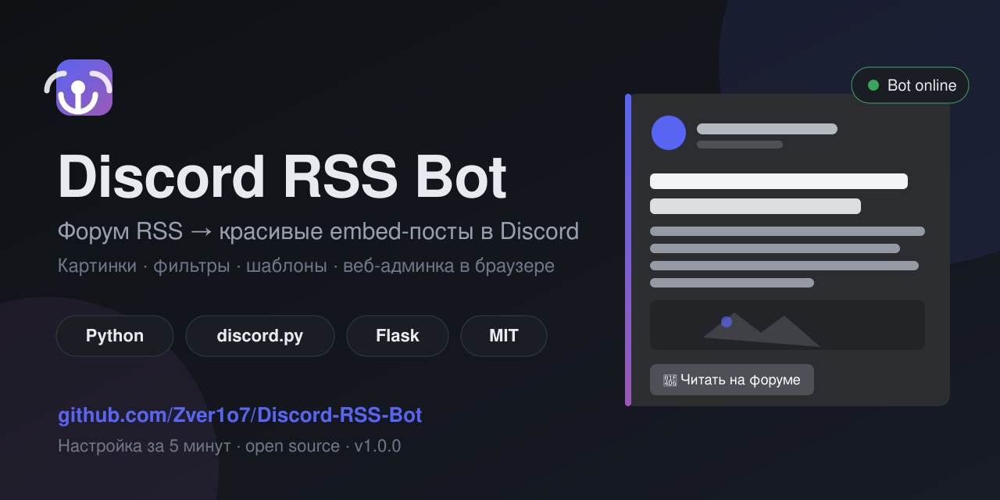
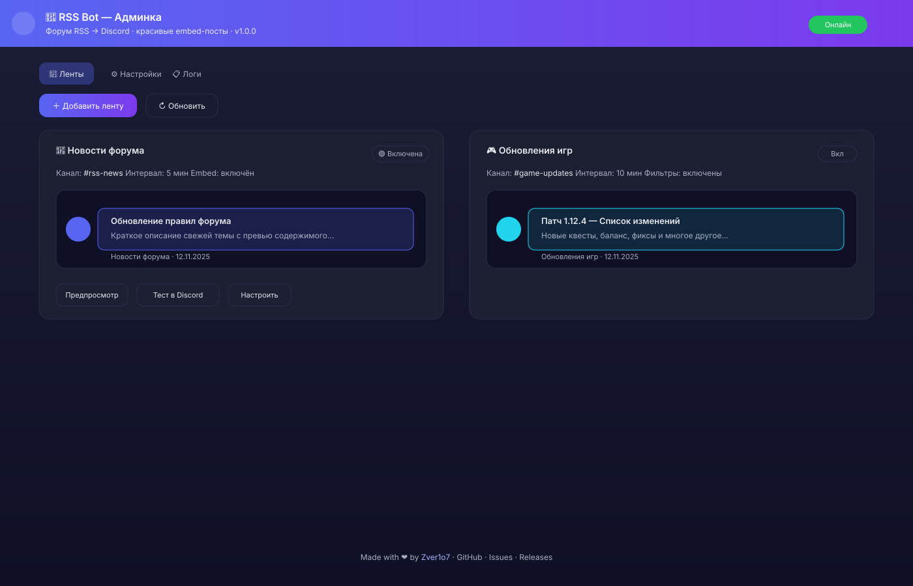
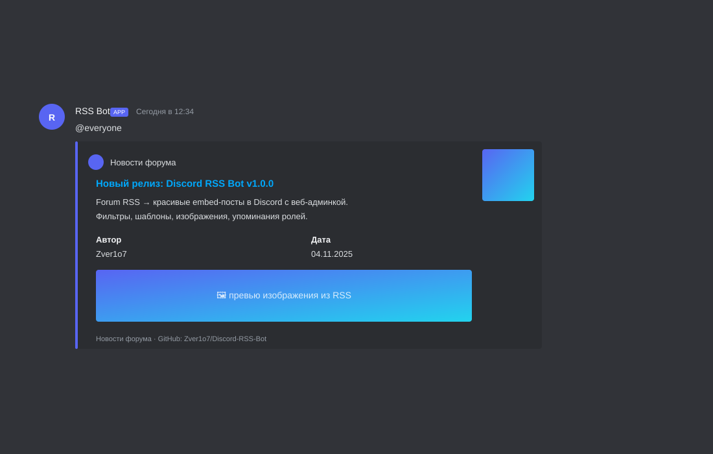

<p align="center">
  
</p>

# Discord RSS Bot

[](https://www.python.org/)
[](https://discordpy.readthedocs.io/)
[](https://flask.palletsprojects.com/)
[](LICENSE)
[](CHANGELOG.md)

> Any forum/site RSS → clean embed posts in Discord. Web admin panel, filters, templates, slash commands.

[🇷🇺 Russian version](README.md)

## Screenshots

<p align="center">
  
</p>

<p align="center">
  
</p>

## Features

- **Any RSS/Atom** — works with most feeds via `feedparser`
- **Clean embeds** — color accent, image, author, date, footer, "Read more" button
- **Web admin** — dark panel at `http://127.0.0.1:8000`. Add/edit/preview/test without touching JSON
- **Webhooks & threads** — post via webhook URL or into a specific thread ID
- **Custom templates** — use `{title}`, `{link}`, `{author}`, `{summary}`, `{date}`, `{feed_name}`, `{tags}`
- **Keyword filters** — include/exclude rules
- **Per-feed intervals** — different check times per feed
- **Import/export** — backup and migrate feeds via JSON
- **Feed duplication** — clone settings quickly
- **Smart first run** — skips history on first launch
- **Live testing** — test posts from web or Discord
- **Stats** — post counter, uptime, `/about`, `/rss-stats`
- **Logs in panel** — see activity at a glance
- **Password protected** — optional auth for web UI
- **Docker** — ready `Dockerfile` and `docker-compose.yml`
- **Visible credits** — console banner, `/about`, web footer

## Slash commands

| Command | Permission | Description |
|---|---|---|
| `/about` | Everyone | Bot info, version, stats, uptime |
| `/rss-ping` | Everyone | Check bot latency |
| `/rss-stats` | Everyone | Quick stats: feeds, posts, uptime |
| `/rss-list` | Everyone | List all feeds with channels/status |
| `/rss-info <feed_id>` | Everyone | Feed settings overview (autocomplete) |
| `/rss-check <feed_id>` | Manage Server | Force check a feed |
| `/rss-toggle <feed_id>` | Manage Server | Enable/disable a feed |
| `/rss-test <feed_id>` | Manage Server | Post a fresh item for testing |
| `/rss-reset <feed_id>` | Manage Server | Reset feed history |
| `/rss-reload` | Manage Server | Reload config without restart |

## Quick start

```bash
git clone https://github.com/Zver1o7/Discord-RSS-Bot.git
cd Discord-RSS-Bot
pip install -r requirements.txt
copy config.example.json config.json
```

Edit `config.json` and add your Discord bot token. Run:

```bash
start.bat
```
or
```bash
python bot.py
```

Open [http://127.0.0.1:8000](http://127.0.0.1:8000) to add your first RSS feed.

See [docs/INSTALL.md](docs/INSTALL.md) and [docs/FORUMS.md](docs/FORUMS.md) for details.

## Docker

```bash
git clone https://github.com/Zver1o7/Discord-RSS-Bot.git
cd Discord-RSS-Bot
copy config.example.json config.json
docker compose up -d --build
```

Admin panel: `http://127.0.0.1:8000`. `config.json` and `data/` are mounted as volumes.

## Author

**[Zver1o7](https://github.com/Zver1o7)**

[Repository](https://github.com/Zver1o7/Discord-RSS-Bot) · [Issues](https://github.com/Zver1o7/Discord-RSS-Bot/issues) · [Releases](https://github.com/Zver1o7/Discord-RSS-Bot/releases)

## License

[MIT License](LICENSE)
