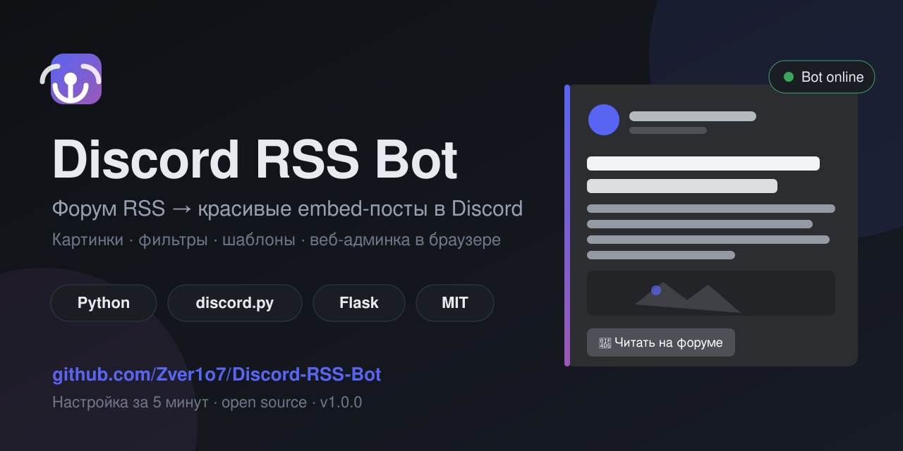
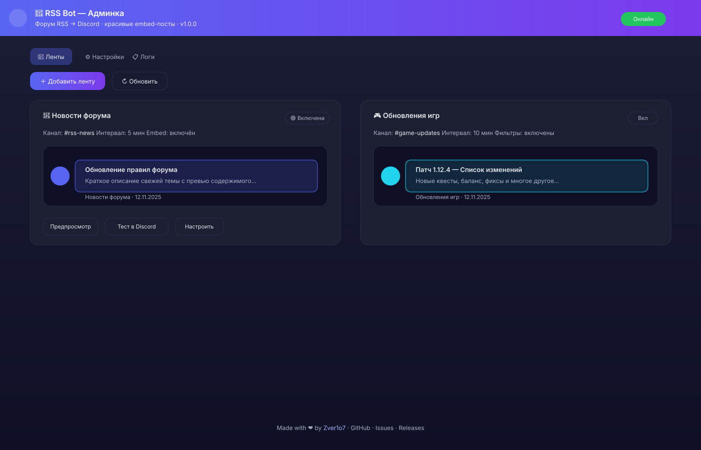
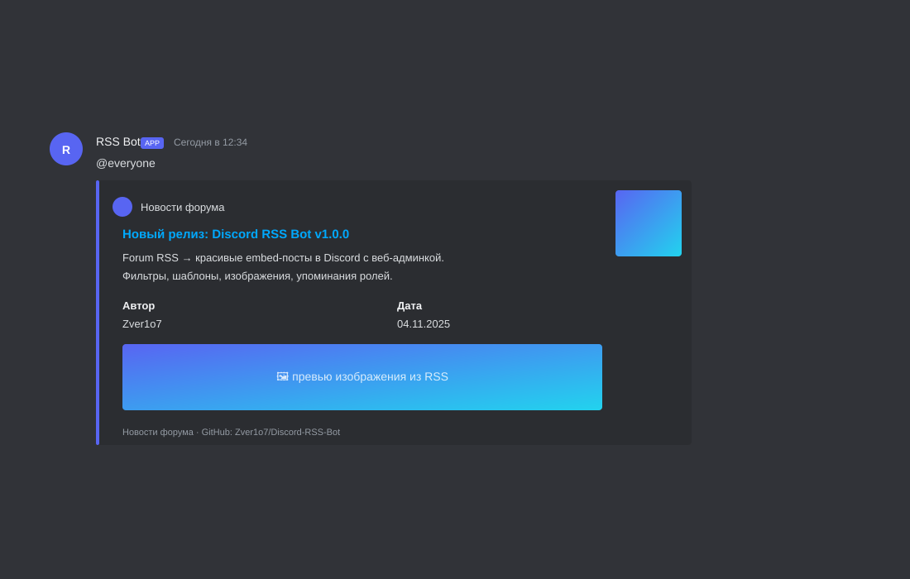

<p align="center">
  
</p>

# Discord RSS Bot

[](https://www.python.org/)
[](https://discordpy.readthedocs.io/)
[](https://flask.palletsprojects.com/)
[](LICENSE)
[](CHANGELOG.md)

> Форум/сайт RSS → красивые посты в Discord. Веб-админка в браузере, фильтры, шаблоны, слэш-команды.

[🇬🇧 English version](README.en.md)

## Для чего

Бот следит за RSS/Atom-лентами и публикует новые записи в выбранный канал Discord в виде аккуратного embed с картинкой, автором, кнопкой и прочим.

## Скриншоты

<p align="center">
  
</p>

<p align="center">
  
</p>

## Возможности

- **Любые RSS/Atom** — универсальный парсер, подходит под большинство источников
- **Красивые embed-посты** — цвет акцента, превью, автор, дата, футер, кнопка «Читать на форуме»
- **Веб-админка в браузере** — тёмная панель на Flask. Добавление, редактирование, фильтры, предпросмотр и тест без правок JSON
- **Кастомные шаблоны** — полный контроль над текстом поста через переменные
- **Фильтры** — «только» и «исключить» по ключевым словам
- **Индивидуальные интервалы** — свой таймаут для каждой ленты
- **Умная синхронизация** — при первом запуске история не публикуется
- **Тест из админки и из Discord** — быстрая проверка перед боевым включением
- **Логи в админке** — сразу видно, что происходит
- **Защита паролем** — опционально для веб-панели
- **Видимое авторство** — баннер в консоли, команда `/about`, футер в админке

## Слэш-команды

| Команда | Права | Описание |
|---|---|---|
| `/about` | Любые | Информация о боте, версия, автор, ссылки |
| `/rss-list` | Любые | Список всех лент, каналов и статусов |
| `/rss-info <feed_id>` | Любые | Настройки выбранной ленты |
| `/rss-check <feed_id>` | Управление сервером | Принудительно проверить ленту |
| `/rss-toggle <feed_id>` | Управление сервером | Включить/выключить ленту |
| `/rss-test <feed_id>` | Управление сервером | Опубликовать свежую запись для теста |

## Быстрый старт

```bash
git clone https://github.com/Zver1o7/Discord-RSS-Bot.git
cd Discord-RSS-Bot
pip install -r requirements.txt
copy config.example.json config.json
```

Открой `config.json`, впиши `discord_token`. Запусти:

```bash
start.bat
```
или
```bash
python bot.py
```

Админка откроется на [http://127.0.0.1:8000](http://127.0.0.1:8000)

Подробная инструкция: [docs/INSTALL.md](docs/INSTALL.md)

## Структура проекта

```text
Discord-RSS-Bot/
├── bot.py
├── rss_core.py
├── webadmin.py
├── templates/dashboard.html
├── docs/
│   ├── INSTALL.md
│   ├── FORUMS.md
│   └── screenshots/
├── config.example.json
├── requirements.txt
├── start.bat
├── CHANGELOG.md
├── LICENSE
└── README.md
```

## Автор

**[Zver1o7](https://github.com/Zver1o7)**

[Репозиторий](https://github.com/Zver1o7/Discord-RSS-Bot) · [Проблемы](https://github.com/Zver1o7/Discord-RSS-Bot/issues) · [Релизы](https://github.com/Zver1o7/Discord-RSS-Bot/releases)

## Лицензия

[MIT License](LICENSE)
